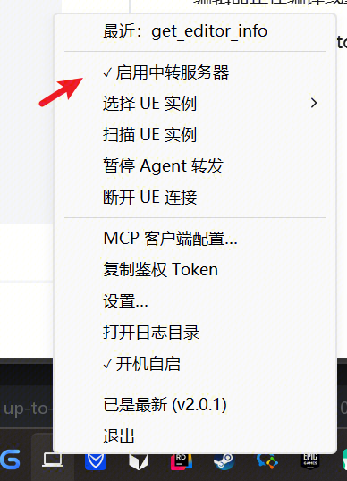
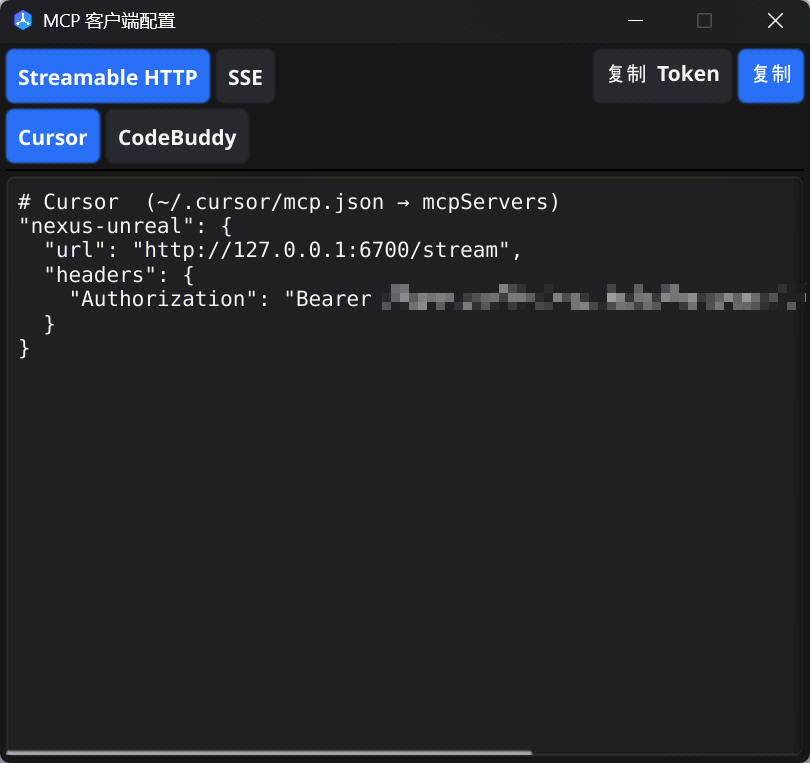

# NexusDesktop — Unreal Engine MCP 桌面客户端

**Language / 语言**: 简体中文 · [English](README.en.md)

**无需 IDE 扩展，连接 AI 与 Unreal Engine。** NexusDesktop 是 [NexusLink — Unreal Engine MCP](https://github.com/bytepine/NexusLink) 的独立桌面客户端，支持 Windows 和 macOS。配合 UE 侧 NexusLink，可让 AI 读取项目、编辑资产和调试运行状态。

[下载 Windows / macOS 安装包](https://github.com/bytepine/NexusDesktop/releases) · [UE 插件（NexusLink）](https://github.com/bytepine/NexusLink) · [下载与安装](#下载与安装) · [NexusLink 文档](https://github.com/bytepine/NexusLink/blob/master/docs/README.md)

程序常驻系统托盘（macOS 菜单栏），提供 UE 实例发现与切换、AI 客户端配置生成和本地 MCP 中转；引擎能力由 NexusLink 提供，经 WebSocket 转发工具调用。

四端端口与开关层数见 [NexusLink 使用指南](https://github.com/bytepine/NexusLink/blob/master/docs/usage-guide.md)。本程序是 **两层** 开关中的客户端层（UE 启用 MCP + 托盘启用中转）。本机不要与 Rider / VSCode 代理同时开。

---

## 依赖

| 组件 | 要求 |
|------|------|
| **NexusDesktop** | 下载 Setup.exe / `.dmg`，无需 Go / Node / 运行时 |
| **NexusLink** | [NexusLink Releases](https://github.com/bytepine/NexusLink/releases)；UE 4.26+ |
| **Windows** | Windows 10 / 11（amd64） |
| **macOS** | macOS 12+（Monterey）；仅 Apple Silicon（arm64） |

---

## 下载与安装

从 [Releases](https://github.com/bytepine/NexusDesktop/releases) 下载：

- **Windows**：`NexusDesktop-windows-amd64-v<版本号>-setup.exe` — 安装向导，可从「应用和功能」卸载
- **macOS**：`NexusDesktop-darwin-arm64.dmg`（仅 Apple Silicon）
- **不要下载 `*-update.zip`**：那是应用内更新包，不是安装包

### Windows 安装与卸载

安装范围仿 Python.org 安装器：

| 范围 | 权限 | 默认目录 |
|------|------|----------|
| 当前用户（默认） | 无需管理员 | `%LOCALAPPDATA%\Programs\NexusDesktop` |
| 全部用户 | 需 UAC | `C:\Program Files\NexusDesktop` |

- 已安装旧版时**原地升级**（沿用目录与范围，配置/日志保留）
- 若已通过应用内更新装上**更新**的版本，再运行旧 Setup 会被拒绝
- 在「当前用户」与「全部用户」之间切换：先卸载再安装
- **卸载**：Windows 设置 → 应用 → NexusDesktop；可选删除 `%APPDATA%\NexusDesktop`
- 配置/日志始终在 `%APPDATA%\NexusDesktop`，与安装范围无关

### 应用内更新

启动后自动检查，之后每 6 小时再查一次。托盘「检查更新」按版本号下载 GitHub Release 上的 **zip 更新包**（不是安装包），解压覆盖后重启。Windows 替换过程不弹出命令行。

设置里 **更新渠道**（默认「跟随当前版本」）：正式安装只收正式版；预发布安装会收更新的 beta 以及同主段正式版，也可改成「仅正式版」。选「包含预发布」时，正式安装可升到更高主段的 beta（不会把 `2.0.0` 降到 `2.0.0-beta.N`）。

| 平台 | 安装包 | 更新包 |
|------|--------|--------|
| Windows | `*-setup.exe` | `*-update.zip`（内含 `NexusDesktop.exe`） |
| macOS | `.dmg` | `*-update.zip`（内含 `NexusDesktop.app`） |

- **macOS**：须先把 `.app` 拖入 `Applications` 再更新；直接从 DMG 运行会失败
- 安装到 `Program Files` 时替换文件会请求一次管理员权限

---

## 使用

### 1. 先准备好 UE

安装并启用 NexusLink，勾选 **启用 MCP 服务器**（步骤见 [usage-guide §2](https://github.com/bytepine/NexusLink/blob/master/docs/usage-guide.md)）。

编辑器 / PIE 使用 **Edit → Editor Preferences → Plugins → NexusLink** 开关；Development / DebugGame 独立 Game / DS 不继承该勾选，须在原启动参数末尾追加 `-EnableNexusMcp`。Shipping 不支持 MCP。

### 2. 启动

**Windows**：Setup 后从开始菜单启动，进入系统托盘。

**macOS**：打开 dmg，将 `NexusDesktop.app` 拖入 `Applications` 后启动。不出现在 Dock，仅菜单栏常驻。

右键托盘图标，勾选 **启用中转服务器**（新安装默认关闭），确认状态行显示目标 UE 工程。多进程时通过 **选择 UE 实例** 切换；没有出现时先执行 **扫描 UE 实例**。



配图用于说明界面位置，截图中的版本号和旧版工具名仅为示例；以当前安装版本及连接返回的工具清单为准。

| 托盘菜单 | 说明 |
|----------|------|
| 状态行 | 始终显示当前 UE 连接（项目名 / 未连接） |
| 选择 UE 实例 | 切换实例 |
| 扫描 UE 实例 | 主动扫端口 |
| 暂停 / 恢复 Agent 转发 | 远端调用在代理排队 |
| ✓ 启用中转服务器 | 启停 MCP HTTP（默认 `:6700`；**新安装默认关**） |
| MCP 客户端配置… | 选协议（Streamable HTTP / SSE）与客户端（Cursor / Windsurf、Claude Code / VS Code、CodeBuddy、Cline、Roo Code、Codex）后复制 JSON / TOML 配置片段；开 LAN 且多网卡时可选 IP；Bearer 仅本机 token |
| 复制身份验证 Token | 只复制本机共享 token |
| 检查更新 | 启动与每 6 小时自动检查；点击下载 zip 并重启 |
| 设置… | 打开设置窗口 |
| 打开日志目录 | 打开日志 |
| 开机自启 | 切换 |
| 退出 | 退出程序 |

唯一实例自动连接；多实例优先 `hostKind=Editor`（旧 UE 无该字段时改用 `netRole=Editor`）。读缓存与断线快照按 UE host/port 隔离，切换实例不会复用另一实例的数据。显式 `targetPort` 须为 1024–65535 的整数；非法值返回 `-32602`，不会转发到当前实例或返回缓存。

批量调用（含部分失败）会清理目标实例的读缓存，失败读取不会进入缓存。大响应临时文件相互隔离，仅清理超过 1 小时的文件。

兼容已发布 2.x 的工具调用格式和当前格式，请求原样转发。新版临时目录与旧 2.x 分开，避免旧进程清理新版结果。

### 3. AI 客户端

推荐从托盘 **MCP 客户端配置…** 选择 **Streamable HTTP** 和对应客户端组，再复制自动生成的配置。URL 和 Token 使用该窗口给出的值；端口冲突时以实际端口为准。

客户端按配置片段格式合并：**Cursor / Windsurf** 共用 `url` 配置；**Claude Code / VS Code** 共用 `type: http/sse`，但分别粘贴到 `.mcp.json` 的 `mcpServers` 与 `.vscode/mcp.json` 的 `servers`。**CodeBuddy**、**Cline**、**Roo Code** 单列，Streamable HTTP 字段分别是 `transportType: streamable-http`、`type: streamableHttp`、`type: streamable-http`。窗口会提示各组的粘贴位置；Windsurf 对应 Cascade 的 `mcp_config.json`。**Codex** 单列，生成可合并到 `~/.codex/config.toml`（或自定义 `CODEX_HOME`）的 TOML，包含地址与按需生成的 `http_headers`，协议固定为 Streamable HTTP；已有同名段时替换，避免重复。[Codex 官方配置说明](https://developers.openai.com/codex/mcp)。



**Cursor**：把生成的服务器条目合并进 `~/.cursor/mcp.json` 的 `mcpServers`（Windows 为 `%USERPROFILE%\.cursor\mcp.json`），保留其他服务器。完整结构如下。Token 也可从托盘「复制身份验证 Token」或设置面板取得，可写多个：`Bearer <tok1>, <tok2>`。规则见 [usage-guide §1.1](https://github.com/bytepine/NexusLink/blob/master/docs/usage-guide.md#11-身份验证)。

```json
{
  "mcpServers": {
    "nexus-unreal": {
      "url": "http://127.0.0.1:6700/stream",
      "headers": {
        "Authorization": "Bearer <token>"
      }
    }
  }
}
```

**CodeBuddy**：选择对应客户端后，将生成的条目粘贴到自定义 MCP 配置中；Streamable HTTP 条目包含 `"transportType": "streamable-http"`。

> Token 是访问凭证。配置示例中的 `<token>` 须替换为实际值；不要把真实 Token 提交到仓库或暴露在文档、聊天及截图中。

#### 验证连接

1. 重启 MCP 会话或重新打开 AI 面板，确认服务器已连接
2. UE 默认 SearchMode 提供 `SearchCapabilities`、`CallCapability`、`SubmitFeedback` 3 个元工具；加上中转的 `list_unreal_instances`、`connect_unreal_instance`，通常共 5 个。首次只见两个实例工具时，先发现并连接 UE，再刷新清单。旧版 UE 使用 snake_case 命名，以实际清单为准
3. 输入 **「使用 MCP 告诉我当前 UE 编辑器信息。」**，核对返回的工程、引擎版本和运行状态

完整的 [图文接入与日常使用示例](https://github.com/bytepine/NexusLink/blob/master/docs/usage-guide.md#3-nexusdesktop) 见 NexusLink 使用指南。

### 4. 设置窗口

从托盘「设置…」打开。中文与混合字体文字使用一致的垂直基线。窗口可调整大小，底部的保存、关闭和状态提示始终可见；修改（包括语言）统一在保存后生效。关闭窗口只藏回托盘，不退出，未保存的修改会放弃。

设置分为「常规」「连接」「安全」：扫描参数、远程 UE 与其他机器的 Token 默认折叠；实例扫描和切换统一从托盘操作。本机与额外 Token 默认隐藏，额外 Token 按需添加。客户端配置窗口采用同样的底部操作区，复制后显示反馈；粘贴位置说明不混入配置片段。

| 配置项 | 默认值 | 说明 |
|--------|--------|------|
| 启用中转服务器 | 关 | 总开关；已有 `config.json` 不受影响 |
| MCP HTTP 端口 | 6700 | AI 客户端端口；保存后立即重启监听 |
| UE 扫描起始 / 结束端口 | 45000 / 45100 | 发现范围 |
| 扫描间隔（秒） | 5 | 定时发现 |
| 写入前确认 | 破坏性操作 | 关闭 / 破坏性（删除、重命名、停 PIE）/ 全部写操作 |
| 更新渠道 | 跟随当前版本 | 正式仅正式版；预发布含 beta（可改成仅正式版或强制含预发布） |
| 允许局域网接入 | 关 | MCP 绑 `0.0.0.0` |
| 启用 MCP 身份验证 | 开 | 关闭后 AI 连本中转无需 Bearer（同旧版）；连 UE 仍看对方身份验证 |
| 额外身份验证 Token | （空） | 点「添加 Token」逐条添加其他机器 token；本机 UE 自动读文件 |
| 远程 UE | （空） | 每行 `host:端口 [token...]` |
| 界面语言 | 跟随系统 | 简体中文 / English |

跨机与身份验证见 [usage-guide §1](https://github.com/bytepine/NexusLink/blob/master/docs/usage-guide.md)。

---

## 日志与断连排查

托盘「打开日志目录」中的 `nexusdesktop_<启动时间>_pid<进程ID>_<分段>_*.log` 记录启动版本、进程 ID、服务器启停原因、MCP 会话创建与握手、会话失效或淘汰、SSE 通断，以及工具调用开始、结束、耗时和错误码。每次启动新建文件，不追加或覆盖上次日志；同次启动超过 4 MiB 后写入新分段。Windows 日志目录为 `%APPDATA%\NexusDesktop\logs`。发布包的 INFO 级别即可看到这些记录，无需开发包；扫描与心跳的常规细节仍在 DEBUG。

会话通过 `session` 摘要关联，同一次服务器运行内的调用通过 `request` 编号关联；`missing_session` 表示客户端未携带会话 ID，`unknown_session` 表示 ID 在当前服务器中不存在。日志不记录 Bearer Token、完整会话 ID、工具参数或响应正文。

最多保留 50 个 MCP 会话；容量满时仅回收超过 30 分钟没有请求、也没有进行中调用或 SSE 连接的会话（`idle_timeout`）。正在初始化或使用的会话不会被新连接淘汰；无法回收时，新连接返回 503 和 `Retry-After`（`session_limit`）。客户端可通过携带会话 ID 的 `DELETE /stream` 主动结束会话（`client_delete`）。回收后的 ID 需要重新 `initialize`。

反馈断连时，请提供报错时间、AI 客户端名称与版本、客户端错误日志，以及对应启动时间和分段的 `nexusdesktop_*.log`；旧版本留下的 `nexusdesktop.log` 仍可用于排查之前的问题。服务器重启后原会话会失效，客户端需要重新 `initialize`，可关闭再开启该 MCP 连接。

UE 重新连接或切换实例后会重新读取 `tools/list`，不沿用上一连接的工具名与参数清单。意外断线期间可保留上次清单；如果 AI 客户端仍缓存旧 Schema，可重新连接该 MCP 服务刷新。

## 本地构建

提交前运行 `go vet ./...` 与 `go test ./...`，其中包含当前 PascalCase 契约和本地 HTTP/WebSocket 多实例转发、旧/新工具名重连刷新、旧连接退出不影响当前连接的回归。无 CGO/OpenGL 的环境可用 `go vet -tags ci ./...` 与 `go test -tags ci ./...` 做无窗口检查；这不代替原生 GUI 构建。

- Go 1.25+
- GCC / MinGW-w64（Windows）或 Xcode CLI（macOS）— Fyne 需要 CGO

**Windows**：

```powershell
$env:CGO_ENABLED = "1"
go build -ldflags "-H=windowsgui -s -w" -o NexusDesktop.exe ./cmd/nexusdesktop/
```

或 `build.bat`。GCC 16+（binutils 2.46+）产生 BigOBJ，Go CGO 暂不支持；用 GCC 14.x（如 [w64devkit v1.23.0](https://github.com/skeeto/w64devkit/releases/tag/v1.23.0)）。release 安装包另需 [Inno Setup 7](https://jrsoftware.org/isdl.php)。

**macOS**：

```bash
python3 scripts/build_desktop.py --build-type develop
# release：python3 scripts/build_desktop.py --build-type release --arch arm64
```

或 `./build.command`。

**Linux（Ubuntu / Debian）**：Fyne 默认同时编译 X11 和 Wayland，先安装原生构建依赖。

```bash
sudo apt-get install -y build-essential libgl1-mesa-dev xorg-dev libxkbcommon-dev libwayland-dev
go vet ./...
go test ./...
```

功能变更写入 [CHANGELOG.md](CHANGELOG.md) `[Unreleased]`。tag 前缀：`nexus-desktop-v`。

---

## License

[MIT](LICENSE) © byteyang
